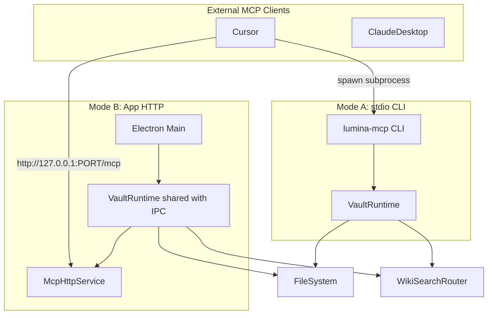

# Lumina MCP Server（CLI + App HTTP）

> **状态：已实现（v0.8.8）。** 使用与配置见 [mcp.md](mcp.md)。与本草案的差异：App 侧不共享 `VaultRuntime`，而是用 `createVaultBackend` 直接包装 IPC 层的实时服务；新增写入工具（`write_wiki_page` / `append_wiki_log`）、`ingest_with_lumina` 与 `answer_from_wiki` / `ingest` Prompt；不使用 sampling。

## 目标

让 Cursor、Claude Desktop 等外部工具通过 MCP 访问 Lumina vault，支持两种模式：



| 模式 | 何时用 | 优势 |
|------|--------|------|
| **stdio CLI** | Lumina 未运行 | 轻量、Cursor `mcp.json` 标准配置 |
| **HTTP（App 内）** | Lumina 正在运行 | 共享 FlexSearch/QMD 热索引，无冷启动 |

**首期范围：只读**。不暴露 `shell`、`save_article`、`request_user_confirmation`。

---

## 架构：抽取 VaultRuntime

当前 vault 初始化散落在 [`src/main/ipc-handlers.ts`](../src/main/ipc-handlers.ts)（`initializeVaultServices`、`attachVaultWatcher`、`initQmdSearch`）和 [`src/main/main.ts`](../src/main/main.ts)。抽取共享层：

**新建 [`src/core/vault-runtime.ts`](../src/core/vault-runtime.ts)**

```typescript
export interface VaultRuntimeOptions {
  vaultPath: string;
  qmdSearch?: QmdSearchConfig;
  watchFiles?: boolean;        // CLI: false; App: true
  onVaultChange?: (event) => void;
  onQmdProgress?: (p) => void;
}

export class VaultRuntime {
  readonly fileSystem: FileSystemService;
  readonly searchRouter: WikiSearchRouter;
  async open(): Promise<void>   // buildIndex + optional QMD init
  async close(): Promise<void>
  // 供 MCP 调用的薄封装
  searchWiki(query, limit?)
  getArticle(filename)
  listArticles()
  getBacklinks(title)
  ingestSource(path, mode?)     // 复用 ingest-tool，无 LLM 时走 markitdown
  getStatus()
}
```

- [`ipc-handlers.ts`](../src/main/ipc-handlers.ts) 改为持有 `VaultRuntime` 实例，IPC handler 委托给 runtime（减少重复逻辑）
- CLI 与 HTTP 共用同一 `VaultRuntime` + MCP tool 注册逻辑

**新建 [`src/core/headless-config.ts`](../src/core/headless-config.ts)**  
CLI 不依赖 Electron `ConfigService`，按优先级解析配置：

1. `--vault /path` CLI 参数
2. `LUMINA_VAULT` 环境变量
3. 读取 electron-store 文件 `~/Library/Application Support/Lumina/llm-wiki-config.json` 中的 `vaultPath`（直接 `fs.readFile`，不 import electron）

QMD 选项：`--qmd` / `--qmd-mode hybrid|lex`，或读取 store 中的 `qmdSearch`。

---

## MCP 层（共享）

**依赖**：`@modelcontextprotocol/server`（与 QMD 同系列，v2 API）

**新建 [`src/mcp/server-factory.ts`](../src/mcp/server-factory.ts)**  
`createLuminaMcpServer(runtime: VaultRuntime): McpServer`，注册工具：

| Tool | 行为 | 底层 |
|------|------|------|
| `search_wiki` | `query`, `limit?` | `runtime.searchWiki()` |
| `get_article` | `filename` | `runtime.getArticle()`，返回 body + frontmatter JSON |
| `list_articles` | `limit?`, `tag?` | `runtime.listArticles()` |
| `get_backlinks` | `title` | `runtime.getBacklinks()` |
| `ingest_source` | `path`, `mode?` | `runIngestTool()`（只读提取，不写 wiki） |
| `lumina_status` | — | vault 路径、文章数、QMD ready/needsEmbedding |

所有 tool 输出为 **紧凑 JSON 字符串**（MCP 惯例），便于 Agent 解析。

**不暴露**：`shell`、写操作、chat session、API key。

---

## Mode A：stdio CLI

**新建 [`src/mcp/cli.ts`](../src/mcp/cli.ts)**（独立入口，不 import electron）

```bash
# 开发
node dist/mcp/mcp/cli.js --vault /path/to/vault [--qmd] [--qmd-mode hybrid]

# 发布后（package.json bin）
lumina-mcp --vault /path/to/vault
```

- 使用 `serveStdio` from `@modelcontextprotocol/server/stdio`
- 日志只写 `stderr`（stdio 协议占用 stdout）
- 进程退出时 `runtime.close()`

**新建 [`tsconfig.mcp.json`](../tsconfig.mcp.json)**  
`include`: `src/mcp/**`, `src/core/**`, `src/main/services/**`（不含 electron 耦合文件）、`src/shared/**`  
`outDir`: `dist/mcp`  
排除：`config-service.ts`、`chat-service.ts`、`chat-history-service.ts` 等 Electron 专用模块

**`package.json` 新增**：

```json
"bin": { "lumina-mcp": "dist/mcp/mcp/cli.js" },
"scripts": { "build:mcp": "tsc -p tsconfig.mcp.json", "mcp": "node dist/mcp/mcp/cli.js" }
```

**Cursor 配置示例**（写入 README 或 `docs/mcp.md`）：

```json
{
  "mcpServers": {
    "lumina": {
      "command": "node",
      "args": ["/path/to/prj-lumina/dist/mcp/mcp/cli.js", "--vault", "/path/to/your/vault"]
    }
  }
}
```

---

## Mode B：App 内嵌 HTTP MCP

**新建 [`src/main/services/mcp-http-service.ts`](../src/main/services/mcp-http-service.ts)**

- 使用 `createMcpHandler` + `toNodeHandler`（`@modelcontextprotocol/node`）
- 绑定 **`127.0.0.1` only**（禁止 `0.0.0.0`）
- 默认端口 **8765**（可配置）
- 每个请求从共享 `VaultRuntime` 构建 `McpServer` factory（与 QMD HTTP 模式类似）
- App 退出 / vault 切换时 `close()` HTTP server

**配置扩展 [`src/shared/types.ts`](../src/shared/types.ts)**：

```typescript
mcpServer: {
  enabled: boolean;   // default false
  port: number;       // default 8765
}
```

**Settings UI**（[`SettingsPanel.tsx`](../src/renderer/components/SettingsPanel.tsx)）：

- Enable MCP server (HTTP)
- Port 输入框
- 状态：Running / Stopped，连接 URL `http://127.0.0.1:8765/mcp`
- 提示：App 运行时优先用 HTTP；未运行时改用 CLI

**生命周期**（[`ipc-handlers.ts`](../src/main/ipc-handlers.ts)）：

- `initializeVaultServices` 完成后，若 `mcpServer.enabled` → `mcpHttp.start(runtime)`
- vault 切换 / App quit → `mcpHttp.stop()`
- `saveConfig` 变更 `mcpServer` → 热重启 HTTP

**Cursor HTTP 配置示例**：

```json
{
  "mcpServers": {
    "lumina": { "url": "http://127.0.0.1:8765/mcp" }
  }
}
```

---

## 与 QMD MCP 的关系

- Lumina MCP **内置** `search_wiki`（FlexSearch + 可选 QMD），外部工具无需再单独配 QMD
- 若用户已配 QMD MCP，可并存：QMD 专搜、Lumina MCP 负责 wiki 结构与 ingest

---

## 测试

| 文件 | 内容 |
|------|------|
| [`src/core/vault-runtime.test.ts`](../src/core/vault-runtime.test.ts) | 用临时 vault 测 search/get/list |
| [`src/mcp/server-factory.test.ts`](../src/mcp/server-factory.test.ts) | tool handler 映射与 JSON 输出 |
| [`src/core/headless-config.test.ts`](../src/core/headless-config.test.ts) | CLI 参数 / env / store 解析 |

HTTP 集成测：vitest + `fetch('http://127.0.0.1:PORT/mcp')` smoke（可选，CI 可 skip）。

---

## 分阶段交付

### Phase 1（本计划核心）

- `VaultRuntime` + MCP tool factory
- stdio CLI `lumina-mcp`
- 只读 6 个 tool
- 文档：`docs/mcp.md`（Cursor / Claude Desktop 配置）

### Phase 2

- App HTTP MCP + Settings UI
- `ipc-handlers` 迁移到 `VaultRuntime`

### Phase 3（后续，不在本期）

- 可选 `save_article`（`--allow-write`）
- HTTP bearer token 认证
- CLI `--connect http://...` 代理到运行中的 App（避免双索引）

---

## 实现任务清单

- [ ] 抽取 VaultRuntime + headless-config，从 ipc-handlers 迁移 vault 初始化逻辑
- [ ] 实现 createLuminaMcpServer：6 个只读 tool（search/get/list/backlinks/ingest/status）
- [ ] 新增 tsconfig.mcp.json + src/mcp/cli.ts + package.json bin/build:mcp 脚本
- [ ] 实现 McpHttpService，App 内 localhost HTTP，Settings 开关与端口配置
- [ ] ipc-handlers 委托 VaultRuntime；vault 切换/quit 时管理 MCP HTTP 生命周期
- [ ] 添加 docs/mcp.md 配置说明 + vault-runtime/mcp-factory 单元测试

---

## 风险与缓解

| 风险 | 缓解 |
|------|------|
| CLI 与 App 双开导致双份 QMD 索引 | 文档说明：App 运行时优先 HTTP；CLI 用于 headless |
| `ingest_source` 需 Python venv | CLI 行为与 Chat 一致，失败时返回清晰错误 |
| MCP SDK v2 与 Node 20 | 与 QMD 相同依赖，已在项目中验证 |
| Electron 打包体积 | MCP CLI 为独立编译产物，不打进 asar 主包 |
